<a href="https://ayushprasad.dev">
  
</a>

  
  
  
  




<a href="https://github.com/Ayush-Prasad4/ledgerlens"></a>

  

<a href="https://github.com/Ayush-Prasad4/inferx"></a>

  

<a href="https://github.com/Ayush-Prasad4/nexusai"></a>

  

<a href="https://github.com/Ayush-Prasad4/LifePilot"></a>

  
  
  



  



  
  
  
  

